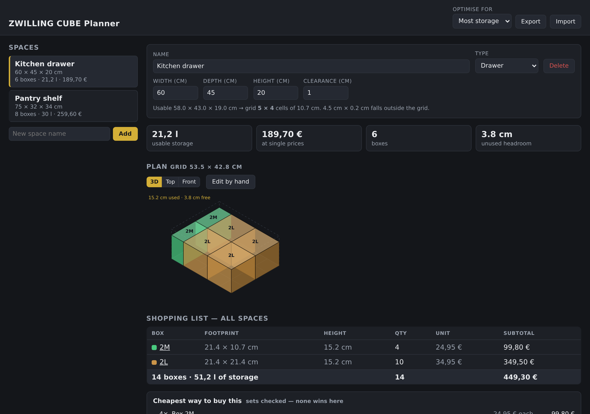
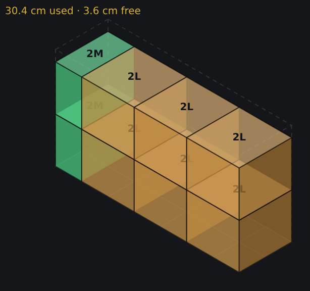
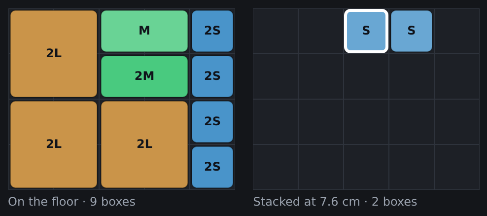
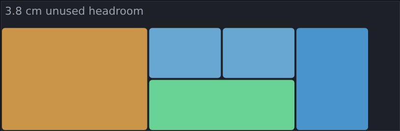
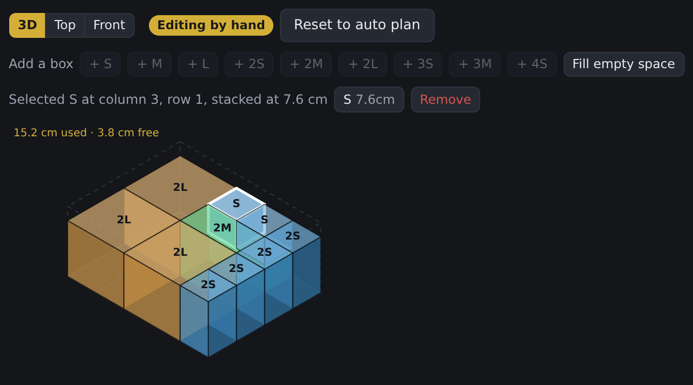
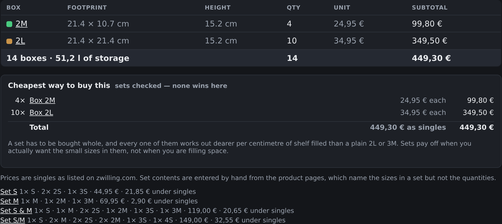

# ZWILLING CUBE Planner

Work out exactly which **ZWILLING Fresh & Save CUBE** boxes fill a drawer or a shelf — how
many, which sizes, how they stack, and what the cheapest way to buy them is.

Type in the inner dimensions of a space, and the planner packs it with real CUBE boxes from
the real catalogue, shows the result in 3D, and rolls every space up into one shopping list
that is checked against ZWILLING's own multi-box sets.



## Why

The CUBE range is a modular grid — every box is a whole number of 10.7 cm cells wide and
comes in one of four heights. That makes "what fits in my drawer?" a packing problem rather
than a shopping decision, and one that is genuinely annoying to do in your head while
standing in a shop. This does it properly.

## What it does

### Packs a space automatically

Give it a width, depth, height and a clearance margin, and pick what to optimise for:

| Objective | Picks the plan that… |
| --- | --- |
| **Most storage** | holds the most litres |
| **Lowest price** | costs the least, sets included |
| **Fewest boxes** | uses the fewest containers |

Filling the space is always the primary goal — the 1 × 1 box means full coverage is always
achievable, so anything else would let "cheapest" degenerate into buying nothing.



### Three views of the same plan

**3D** shows the whole stack inside the cavity outline, with the unused headroom drawn as a
dashed volume. **Top** splits the plan into one grid per stacking level. **Front** is a
straight elevation of the front row, which is the view that tells you whether the lid will
clear the drawer runner.

| Top | Front |
| --- | --- |
|  |  |

### Edit by hand

The automatic plan is a starting point. Switch to hand editing and you can drag boxes around,
drop one onto another to stack it, swap a box for any other size that still fits in its slot,
delete boxes, or hit **Fill empty space** to top up whatever is left.

Boxes obey gravity: a box always settles onto whatever is beneath it, and a placement is only
accepted if every cell underneath reaches the same height — no overhangs, no floating boxes.
Remove a support and the stack above it falls.



### One shopping list for every space

All spaces are merged into a single list of boxes with prices and total capacity, and then the
purchase optimiser searches ZWILLING's sets to see whether buying any of them beats buying
singles — including the case where a set leaves you with a surplus box and is *still* cheaper.
Every SKU links straight to its product page.



At current prices the answer is usually "buy singles": every set works out dearer per
centimetre of shelf filled than a plain 2L or 3M. The app says so out loud instead of leaving
you wondering whether the sets were considered.

## The model

- **Grid**: one cell is 10.7 × 10.7 cm. Footprints are S (1 × 1), M (2 × 1) and L (2 × 2).
- **Heights**: 7.6, 15.2, 22.8 and 29.5 cm. The SKU code is `<height step><footprint>`, so
  `3M` is an M footprint at the third height step. The "/ 11 cm" in the product names is the
  footprint's long edge, not the height.
- **Clearance**: subtracted from every inner dimension, once per side horizontally and once
  vertically, for drawer runners and lips.
- **Placements**: a flat list of boxes with an `(x, y)` cell and a derived `zCm`. There is no
  layer model — a 22.8 cm box can stand next to a column of three 7.6 cm boxes.

The catalogue in [src/data/catalog.json](src/data/catalog.json) was scraped once from
zwilling.com and committed; the app never touches the network at runtime. Set contents are
hand-entered in [src/data/sets.json](src/data/sets.json), because the product pages name the
sizes in a set but never the quantities.

Your plans live in `localStorage`, and **Export** / **Import** move them between browsers as
a JSON file.

## Getting started

Requires the Node version in [.nvmrc](.nvmrc).

```bash
npm install
npm run dev
```

| Script | What it does |
| --- | --- |
| `npm run dev` | Vite dev server |
| `npm run build` | type-check and build to `dist/` |
| `npm test` | Vitest (83 tests over the packer, editor, solver and pricing) |
| `npm run lint` | ESLint |
| `npm run typecheck` | `tsc -b` |
| `npm run scrape` | re-scrape the ZWILLING catalogue (Playwright) |
| `npm run screenshots` | regenerate the screenshots in this README |

`npm run screenshots` expects a dev server to already be running; point it elsewhere with
`APP_URL=http://localhost:5174/ npm run screenshots`.

## Layout

```
src/
  data/      scraped catalogue + hand-entered set contents
  domain/    packing, free 3D stacking, plan solving, purchase optimisation
  components/  isometric, top and front views, shopping list, editors
  state/     localStorage-backed planner state, import/export
scripts/     one-off scrapers and the screenshot runner
```

Everything in `domain/` is pure and unit-tested; the React layer only renders and drags.

## Deployment

[CI](.github/workflows/ci.yml) runs lint, type-check, tests and a build on every push and pull
request. Publishing a GitHub release triggers
[the Pages deploy](.github/workflows/deploy.yml), which builds with `BASE_PATH` set to the
repository name so the bundle works from a project page.

## Notes

Not affiliated with, endorsed by or connected to ZWILLING. Prices, dimensions and capacities
are whatever the German shop listed at the time of the scrape and will drift — re-run
`npm run scrape` if the numbers matter to you.
